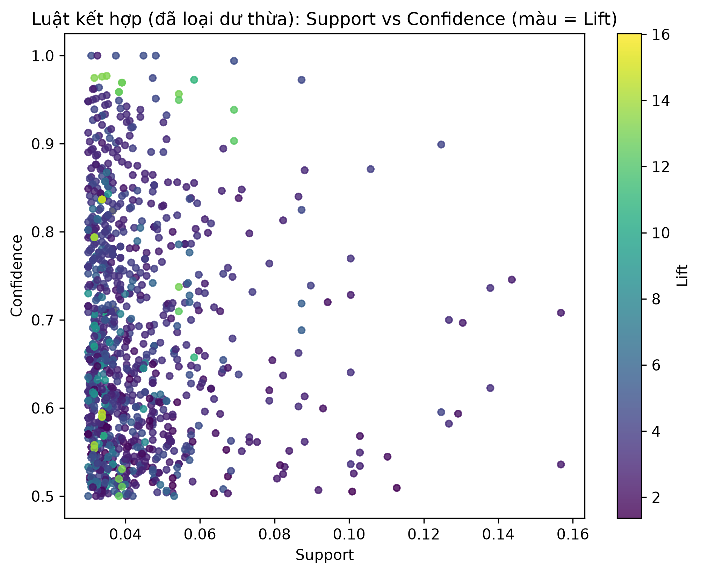
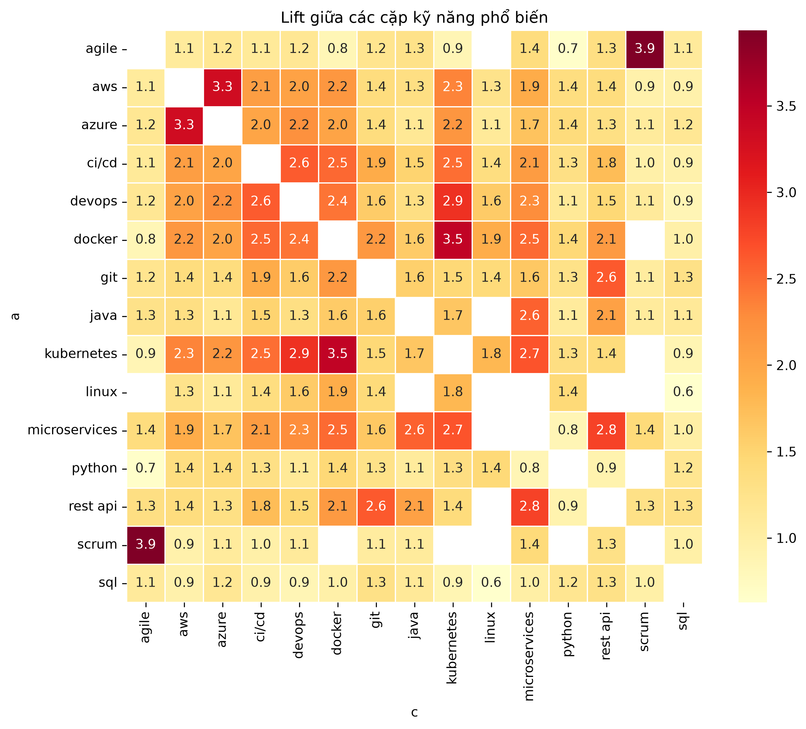

# BÁO CÁO BƯỚC 2.4: KHAI PHÁ LUẬT KẾT HỢP KỸ NĂNG TRONG TIN TUYỂN DỤNG IT

> **Một câu tóm tắt:** từ 2.843 tin tuyển dụng IT, ta rút ra **1.027 luật kết hợp chất lượng**. Chúng cho thấy thị trường chia thành các cụm kỹ năng khá rõ, mạnh nhất là cụm **DevOps/Cloud** (Docker, Kubernetes, AWS, Azure), trong khi **Python và SQL phổ biến nhất nhưng lại ít gắn kết nhất** với các kỹ năng khác.

## Mục lục
1. [Mục tiêu và bài toán](#1-mục-tiêu-và-bài-toán)
2. [Dữ liệu và tiền xử lý](#2-dữ-liệu-và-tiền-xử-lý)
3. [Phương pháp và tham số](#3-phương-pháp-và-tham-số)
4. [Kết quả](#4-kết-quả)
5. [Phân tích biểu đồ](#5-phân-tích-biểu-đồ)
6. [Kiểm tra độ tin cậy](#6-kiểm-tra-độ-tin-cậy)
7. [Thảo luận](#7-thảo-luận)
8. [Hạn chế](#8-hạn-chế)
9. [Kết luận](#9-kết-luận)

---

## Phát hiện chính (đọc nhanh)

| # | Phát hiện | Bằng chứng |
|:-:|---|---|
| 1 | **DevOps/Cloud là cụm gắn kết mạnh nhất** | Docker ⇄ Kubernetes lift 3,33; AWS ⇄ Azure 3,22; Kubernetes ⇄ DevOps 2,85 |
| 2 | **Python và SQL là "kỹ năng nền", ít gắn kết** | Lift Python ⇒ SQL chỉ 1,14; SQL ⇒ DevOps chỉ 0,83 (< 1) |
| 3 | **Luật 100% phần lớn là hiển nhiên** | Spring ⇒ Java (117/117), FastAPI ⇒ Python (79/79) |
| 4 | **Luật mạnh thì hẹp, luật rộng thì yếu** | 90,8% luật có support dưới 6%; chỉ 8 luật vừa phổ biến (≥ 10%) vừa chắc (≥ 70%) |
| 5 | **Bộ luật ổn định khi đổi mẫu số** | 1.225/1.228 luật vẫn đạt ngưỡng khi tính trên 2.843 tin |

---

## 1. Mục tiêu và bài toán

**Câu hỏi nghiên cứu:** trong các tin tuyển dụng IT, những kỹ năng nào thường được yêu cầu **cùng nhau**, và mức độ gắn kết giữa chúng mạnh đến đâu?

**Cách mô hình hóa:** bài toán được xem như phân tích giỏ hàng. Mỗi tin tuyển dụng là một "giỏ hàng", mỗi kỹ năng (python, sql, docker...) là một "món hàng". Luật `A ⇒ B` diễn đạt: *tin nào yêu cầu A thì thường cũng yêu cầu B*.

**Đầu ra mong muốn:** một tập luật kết hợp gọn, đã loại luật yếu và luật dư thừa, kèm diễn giải dùng được cho định hướng học tập và tuyển dụng.

## 2. Dữ liệu và tiền xử lý

### 2.1. Từ 3.135 tin đến 2.430 giỏ kỹ năng

```
3.135 tin ──► 2.869 tin ──► 2.843 tin ──► 2.430 giỏ ──► ma trận 2.430 × 121
 (file)     (thuộc phạm vi   (có JD sạch)   (≥ 2 kỹ năng)    (One-Hot)
              IT sơ bộ)
```

| Bước | Số tin / giỏ | Lý do |
|---|---:|---|
| Toàn bộ file `clean_data_processed.csv` (47 cột, 5 nguồn, một đợt thu thập) | 3.135 | — |
| `scope_status == "included_provisional"` | 2.869 | 266 tin `pending_review` (phần lớn là PM/PO, Scrum Master, BA) chưa được xác nhận là việc làm IT |
| `has_jd_clean == True` | **2.843** | Cột `skills` gộp kỹ năng từ tiêu đề, thẻ và JD; tin không có JD vẫn có thể mang kỹ năng mà ta chưa đọc được trong mô tả |
| Giữ kỹ năng có ≥ 30 tin (121/157 kỹ năng) và bỏ tin dưới 2 kỹ năng | **2.430 giỏ** | Giỏ chỉ có một món thì không tạo được luật `A ⇒ B` |

Bộ lọc đầu giống bước 2.2 và 2.3 để ba bước dùng chung một mẫu số.

**Số giỏ theo nguồn:** TopCV 894, LinkedIn 591, ITviec 496, VietnamWorks 396, TopDev 53.

> **Lưu ý về mẫu số.** Từ đây trở đi, mọi support, confidence và lift được tính trên **2.430 giỏ** (tin nêu ít nhất 2 kỹ năng), không phải trên 2.843 tin. Mục 6.1 đo mức chênh lệch.

### 2.2. Chọn và xử lý thuộc tính

- **Chọn cột `skills`** trong 8 cột khảo sát (`title`, `tech_list`, `keywords_list`, `skills`, `broad_concepts`, `application_domains`, `languages`, `benefits`), vì nó sạch và đúng nghĩa "kỹ năng yêu cầu". Trộn cột khác loại như `benefits` sẽ cho luật khó diễn giải.
- **Chuẩn hóa:** đọc chuỗi JSON thành danh sách, `strip()` + `lower()`, dùng `set` để loại kỹ năng trùng trong cùng một tin.
- **Loại kỹ năng hiếm:** `MIN_COUNT = 30` loại 36 kỹ năng, giữ 121.
- **One-Hot:** `TransactionEncoder` biến giỏ thành ma trận True/False 2.430 × 121 vì `mlxtend` chỉ nhận bảng boolean. Ma trận rất thưa, đúng đặc điểm dữ liệu giỏ hàng.

### 2.3. Kỹ năng nào phổ biến nhất?

| Hạng | Kỹ năng | Tỷ lệ trong 2.430 giỏ |
|:-:|---|---:|
| 1 | python | 36,8% |
| 2 | sql | 32,2% |
| 3 | ci/cd | 29,3% |
| 4 | docker | 22,1% |
| 5 | aws | 21,8% |
| 6–10 | java, agile, git, linux, devops | khoảng 19–21% |

Danh sách trộn ba nhóm: **ngôn ngữ** (Python, Java, SQL), **quy trình** (Agile, CI/CD) và **hạ tầng** (Docker, AWS, Linux). Tin tuyển dụng IT đòi hỏi cả kỹ năng lập trình lẫn vận hành.

## 3. Phương pháp và tham số

### 3.1. Các thước đo

| Thước đo | Công thức | Cách đọc |
|---|---|---|
| Support(X) | số giỏ chứa X ÷ tổng số giỏ | Tổ hợp phổ biến đến mức nào |
| Confidence(A⇒B) | Support(A∪B) ÷ Support(A) = P(B\|A) | Trong các tin có A, bao nhiêu % có B |
| Lift | Confidence ÷ Support(B) | > 1: kéo nhau lên; = 1: độc lập; < 1: ít đi cùng nhau hơn kỳ vọng |
| Conviction | (1 − Support(B)) ÷ (1 − Confidence) | Luật "sai" ít hơn đoán ngẫu nhiên bao nhiêu lần; ∞ khi confidence = 100% |

Confidence **bất đối xứng** (`conf(A⇒B) ≠ conf(B⇒A)`), còn Lift **đối xứng**.

### 3.2. Bảng tham số

| Tham số | Giá trị | Tác dụng |
|---|:-:|---|
| `MIN_COUNT` | 30 | Giữ kỹ năng có ở ≥ 30 tin |
| `MIN_SUP` | 0,03 | Tổ hợp phải có ở ≥ 3% giỏ (≥ 73 giỏ) |
| `max_len` | 4 | Tối đa 4 kỹ năng một tổ hợp (luật dài khó đọc) |
| `MIN_CONF` | 0,5 | Ít nhất một nửa tin có A thì có B |
| `MIN_LIFT` | 1,2 | Loại luật độc lập hoặc ngược chiều |
| `MIN_CONV` | 1,2 | Luật phải đáng tin hơn đoán ngẫu nhiên |

### 3.3. Quy trình khai phá

1. **Tập phổ biến:** Apriori, kiểm chứng chéo bằng FP-Growth.
2. **Sinh luật:** `association_rules` với `min_threshold = 0` để giữ toàn bộ luật thô, kể cả luật yếu hoặc ngược chiều (phục vụ tra cứu và vẽ heatmap).
3. **Lọc luật:** áp dụng đồng thời bốn ngưỡng support, confidence, lift, conviction.
4. **Loại luật dư thừa:** luật `A ⇒ C` bị loại nếu có luật ngắn hơn `A' ⇒ C` đã qua lọc, với `A'` là tập con thật sự của `A` và confidence không thấp hơn.
5. **Xếp hạng, kiểm tra độ nhạy, trực quan hóa.**

## 4. Kết quả

### 4.1. Tập phổ biến

Apriori tìm được **856 tập phổ biến**: 79 tập một kỹ năng, 351 tập hai, 331 tập ba và 95 tập bốn. Số tập đạt đỉnh ở kích thước 2 rồi giảm vì tổ hợp càng dài càng khó đạt ngưỡng 3%.

FP-Growth cho **cùng 856 tập**, xác nhận kết quả đúng. Về thời gian, Apriori mất 0,102 s và FP-Growth 0,279 s, ngược với lý thuyết. Lý do là dữ liệu nhỏ và `max_len = 4` nên chi phí dựng cây FP-tree không đáng. Với thời gian cỡ phần trăm giây và chỉ đo một lần, không nên kết luận mạnh về tốc độ.

### 4.2. Phễu lọc luật

| Giai đoạn | Số luật |
|---|---:|
| Luật thô | 4.018 |
| Sau lọc theo ngưỡng | 1.228 (~31%) |
| Dư thừa bị loại | 201 (198 luật vế phải 1 kỹ năng, 3 luật vế phải 2 kỹ năng) |
| **Luật chất lượng cuối cùng** | **1.027** |

**Vì sao phải loại luật dư thừa?** Nếu không, 8 trong 15 dòng đầu bảng Top Confidence chỉ là biến thể dài hơn của `spring ⇒ java` hoặc `spring boot ⇒ java`.

| Luật | Đếm | Kết luận |
|---|:-:|---|
| `spring ⇒ java` | 117/117 | Giữ (luật ngắn nhất) |
| `{spring, spring boot} ⇒ java` | 83/83 | **Dư thừa**: `spring ⇒ java` cũng 100% nhưng áp dụng cho 117 tin |
| `{ci/cd, spring boot} ⇒ java` | 83/84 | **Dư thừa**: thêm CI/CD làm confidence giảm so với 99,41% |
| `{rest api, spring boot} ⇒ java` | 109/109 | Giữ: thêm REST API làm confidence tăng từ 99,41% lên 100% |

Trong 1.027 luật còn lại, 846 luật (82%) có vế phải một kỹ năng, và 862 luật (84%) có từ hai kỹ năng ở vế trái trở lên.

### 4.3. Top luật theo Lift: cặp kỹ năng gắn kết bất ngờ

| Luật | Support | Confidence | Lift |
|---|:-:|:-:|:-:|
| `android ⇄ ios` | 3,7% | 71,2% / 82,4% | **16,0** |
| `{html, javascript} ⇒ {css, git}` | 3,4% | 59,4% | 14,7 |
| `{html, react} ⇒ css` | 3,5% | 97,7% | 13,3 |
| `html ⇄ css` | 6,9% | 90,3% / 93,9% | 12,3 |
| `c ⇒ c++` | 5,8% | 97,3% | 10,9 |
| `rabbitmq ⇒ kafka` | 3,5% | 84,3% | 8,8 |

Hai cụm nổi bật: **mobile** (Android + iOS) và **web front-end** (HTML, CSS, JavaScript, React, Git, REST API). Lift cao nghĩa là hai kỹ năng đi cùng nhau nhiều hơn rất nhiều so với việc xuất hiện ngẫu nhiên.

### 4.4. Top luật theo Confidence: quan hệ phụ thuộc

Năm luật đạt **100%**: `spring ⇒ java` (117/117), `{rest api, spring boot} ⇒ java` (109/109), `{spring boot, sql} ⇒ java` (75/75), `fastapi ⇒ python` (79/79) và `{rest api, scrum} ⇒ agile` (91/91).

Đây chủ yếu là quan hệ **"framework thuộc ngôn ngữ"**: đúng trong mẫu nhưng hiển nhiên về kỹ thuật, không phải phát hiện về thị trường. Riêng `spring boot ⇒ java` là 168/169 = 99,41% vì có đúng một ngoại lệ.

> **Cách dùng hai bảng xếp hạng:** *Lift* cho thấy **cụm kỹ năng của ngành**; *Confidence* cho thấy **quan hệ phụ thuộc kỹ thuật**. Cần đọc cả hai.

### 4.5. Các luật theo chủ đề (tính trên 2.430 giỏ)

| Luật | Support | Confidence | Lift | Nhận xét |
|---|:-:|:-:|:-:|---|
| docker ⇒ kubernetes | 13,8% | 62,3% | 3,33 | Có Docker thì khoảng 62% có Kubernetes |
| kubernetes ⇒ docker | 13,8% | **73,6%** | 3,33 | Chiều ngược lại mạnh hơn |
| docker, kubernetes ⇒ aws | 6,9% | 49,9% | 2,29 | Nhóm container thường kèm AWS |
| python ⇒ sql | 13,5% | 36,8% | **1,14** | Liên kết yếu |
| machine learning ⇒ python | 5,3% | **80,0%** | 2,17 | Python gần như đi kèm ML |
| spring ⇒ java | 4,8% | **100%** | 4,77 | Tuyệt đối trong mẫu |
| sql ⇒ devops | 5,1% | 16,0% | **0,83** | Ít đi cùng nhau hơn kỳ vọng |
| linux ⇒ devops | 6,0% | 30,1% | 1,56 | Liên kết khá rõ |

**Một "luật vắng mặt" cần đọc đúng:** `{python, sql} ⇒ machine learning` không xuất hiện ở ngưỡng support 3%. Tổ hợp ba kỹ năng có 56 giỏ (2,30%), thiếu 17 giỏ so với ngưỡng 73 giỏ; confidence cũng chỉ 17,0% (< 50%). Kết luận đúng là *"không tìm thấy luật ở ngưỡng đã chọn"*, không phải *"ba kỹ năng không đi cùng nhau"*.

## 5. Phân tích biểu đồ

Hình 1 nhìn **toàn bộ bộ luật**, Hình 2 nhìn **từng cặp kỹ năng cụ thể**.

### 5.1. Biểu đồ 1: Support × Confidence (màu = Lift)



*Hình 1. Mỗi chấm là một luật trong 1.027 luật đã loại dư thừa; màu thể hiện lift (1,4 → 16,0).*

**Nhận xét**

- **Phần lớn luật nằm ở support thấp.** 90,8% luật có support dưới 6% (trung vị 3,7%), còn bên phải mốc 10% gần như trống, chỉ có 23 luật. Nguyên nhân là 84% luật có từ hai kỹ năng ở vế trái, mà tổ hợp càng dài càng hiếm.
- **Vùng "vừa phổ biến vừa chắc" rất ít luật.** Chỉ 8 luật có support ≥ 10% và confidence ≥ 70%, và cả 8 đều thuộc DevOps/Cloud hoặc Agile: `docker ⇒ ci/cd` (15,7%), `devops ⇒ ci/cd` (14,4%), `kubernetes ⇒ docker` (13,8%), `azure ⇒ aws` (12,7%), `scrum ⇒ agile` (12,5%), `google cloud ⇒ aws` (10,6%) và hai luật ba kỹ năng của Docker/Kubernetes/CI-CD.
- **Luật càng phổ biến thì lift càng thấp.** Các chấm phía phải có màu tím đến xanh dương (lift 2–4), vì vế phải vốn đã xuất hiện nhiều. Tương quan support–lift là −0,14 (yếu nhưng ngược chiều).
- **Lift cao nhất tập trung ở góc trên bên trái.** Có 62 luật lift ≥ 8, trong đó 60 luật có support dưới 6%. Cụm chấm xanh lá và vàng ở confidence 95–98% là các luật web front-end như `{html, react} ⇒ css`.
- **Luật 100% không phải luật gắn kết nhất.** Năm chấm ở confidence = 1,0 (Spring, FastAPI, Scrum) chỉ có màu xanh dương, lift khoảng 4,8, thấp hơn nhiều so với cụm front-end.
- **Hai cạnh của biểu đồ do ngưỡng lọc tạo ra.** Không có chấm nào dưới 0,5 hay bên trái 0,03 vì đó là `MIN_CONF` và `MIN_SUP`. Ở dải support 3–6% các chấm chồng lên nhau nhiều, nên số luật thực tế dày hơn những gì mắt thấy.

**Kết luận:** luật mạnh thường chuyên biệt (support thấp, lift cao), còn luật phổ biến thì gắn kết vừa phải. Không có luật nào nổi trội ở cả ba thước đo, nên cần xem đồng thời support, confidence và lift.

### 5.2. Biểu đồ 2: Heatmap Lift của 15 kỹ năng phổ biến nhất



*Hình 2. Lift của luật một kỹ năng trong bộ luật thô (nên có cả ô dưới 1). Ô trống là cặp không đạt support 3%.*

**Nhận xét**

- **Nhóm DevOps/Cloud tạo thành một khối đỏ rõ nhất.** Giữa `docker`, `kubernetes`, `devops`, `ci/cd`, `aws`, `azure`, `microservices`, `postgresql`, lift phần lớn từ 1,9 đến 3,3. Đậm nhất là `docker ⇄ kubernetes` (3,33), `aws ⇄ azure` (3,22), `kubernetes ⇄ devops` (2,85) và `microservices ⇄ rest api` (2,68).
- **AWS và Azure có lift 3,2 dù là hai nền tảng cạnh tranh.** Có thể nhiều tin liệt kê nhiều nền tảng cloud cùng lúc, không nhất thiết đòi biết cả hai.
- **SQL gần như không kéo theo kỹ năng nào.** Lift của SQL chỉ từ 0,6 đến 1,4, và dưới 1 với `linux` (0,6, thấp nhất bảng), `devops` và `kubernetes` (0,8), `aws`, `ci/cd`, `docker` (0,9). Giá trị cao nhất là `postgresql` (1,4), điều dễ hiểu vì cùng thuộc nhóm cơ sở dữ liệu.
- **Python cũng tương tự:** lift với `agile` 0,7, `microservices` 0,8, `rest api` 0,9, còn với `java` và `postgresql` khoảng 1,0. Python và SQL là hai kỹ năng phổ biến nhất nhưng xuất hiện ở mọi loại việc, nên không đặc trưng cho cụm nào.
- **Có hai hướng tách biệt:** nhóm hạ tầng/vận hành (khối đỏ) và nhóm lập trình/dữ liệu nền (Python, SQL, màu nhạt). Phù hợp với luật `sql ⇒ devops` có lift 0,83.
- **Một số ô trống:** `linux` không có luật với `agile`, `java`, `microservices`, nghĩa là các tổ hợp này không đạt 3% giỏ. Linux nghiêng về mảng vận hành hơn mảng phát triển ứng dụng.
- **Hạn chế:** chỉ có 15 kỹ năng nên không thấy cụm front-end và Java/Spring (đã nằm ở Hình 1 và bảng 4.3). `scrum ⇄ agile` cũng không có vì Scrum rớt khỏi top 15 sau khi loại 103 tin chưa xác nhận.

**Kết luận:** cụm DevOps/Cloud là nơi các kỹ năng gắn kết chặt nhất, còn Python và SQL là kỹ năng nền ít đi kèm kỹ năng khác. Ví dụ, tin có Docker thường kèm Kubernetes (3,33), PostgreSQL (2,5) và CI/CD (2,4). Đây là mô tả cách nhà tuyển dụng liệt kê kỹ năng, chưa đủ để làm lộ trình học nếu không kiểm chứng thêm.

Hai biểu đồ và ba file CSV (`frequent_itemsets.csv`, `association_rules_filtered.csv`, `association_rules_nonredundant.csv`) được lưu trong thư mục `output/`.

## 6. Kiểm tra độ tin cậy

### 6.1. Đổi mẫu số: 2.430 giỏ so với 2.843 tin

Tính lại mười luật chủ đề trên toàn bộ 2.843 tin:

| Thước đo | Thay đổi | Ví dụ |
|---|---|---|
| Support | Giảm khoảng 14,5% (mẫu số tăng) | Docker–Kubernetes: 13,79% → 11,78% |
| Confidence | Gần như không đổi (6/10 cặp giống hệt, 4/10 giảm ≤ 1,5 điểm %) | ML ⇒ Python: 80,0% → 78,5% |
| Lift | **Tăng ở mọi luật** (×1,03 đến ×1,17) | Python ⇒ SQL: 1,14 → **1,28** |

- Nhận định "Python và SQL liên kết yếu" **phụ thuộc mẫu số**: lift 1,28 đã vượt ngưỡng 1,2, nhưng luật vẫn bị loại vì confidence chỉ khoảng 36% (< 50%). Nên viết "yếu đến vừa" thay vì "không liên quan".
- **Bộ luật ổn định:** 1.225/1.228 luật vẫn đạt ngưỡng khi tính trên 2.843 tin. Ba luật rớt (`c# ⇒ .net` 49,8%, `linux ⇒ python` 49,4%, `html ⇒ {css, rest api}` 49,7%) đều do confidence tụt sát dưới 50%.
- Nếu đòi thêm support ≥ 3% của 2.843 tin (≥ 86 tin) thì còn **705** luật. Số luật phụ thuộc mẫu số, còn confidence và lift của từng luật thì ít đổi.

### 6.2. Luật gây nhiễu

- **Không có luật nào** có confidence ≥ 0,6 mà lift < 1,5. Điều này có cơ sở toán học: muốn vậy support vế phải phải > 0,4, trong khi kỹ năng phổ biến nhất (Python) chỉ 36,8%. Trong bộ dữ liệu này, "bẫy" kinh điển (vế phải quá phổ biến) không thể xảy ra.
- **8 luật có conviction vô cực** (confidence = 100%), trong đó 3 luật dư thừa. Conviction vô cực chỉ nói không có ngoại lệ trong mẫu, chưa phải quy luật tuyệt đối.
- `ai` và `cloud` **không có** trong ma trận vì bước 2.1 đã tách chúng sang `broad_concepts`. Trước khi hỏi về một chủ đề, cần kiểm tra tên mục trong `onehot.columns`.

### 6.3. Độ nhạy của `MIN_COUNT`

| `MIN_COUNT` | Kỹ năng giữ | Giỏ | Tập phổ biến | Luật thô | Luật qua lọc |
|:-:|:-:|:-:|:-:|:-:|:-:|
| 10 | 145 | 2.437 | 832 | 3.870 | 1.182 |
| **30** | 121 | 2.430 | 856 | 4.018 | 1.228 |
| 50 | 99 | 2.405 | 856 | 4.018 | 1.228 |
| 73 | 79 | 2.371 | 879 | 4.156 | 1.280 |
| 100 | 64 | 2.333 | 913 | 4.498 | 1.374 |

Từ 30 đến 50 bộ luật **không đổi**, vì các kỹ năng bị loại thêm đều dưới 73 giỏ nên dù giữ lại cũng không đạt `MIN_SUP`. Tham số quyết định thật sự là **`MIN_SUP`**, không phải `MIN_COUNT`; không nên mô tả mức 30 là "điểm cân bằng tối ưu".

## 7. Thảo luận

1. **Cụm kỹ năng rõ rệt:** web front-end, mobile (Android + iOS), Java backend (Spring), DevOps/Cloud và Data/ML (ML ⇒ Python).
2. **Quan hệ có hướng:** 73,6% tin có Kubernetes cũng có Docker, so với 62,3% chiều ngược lại. Hai luật có cùng tử số (335 giỏ), chỉ khác mẫu số vì Kubernetes (455 giỏ) ít phổ biến hơn Docker (538 giỏ). Điều này phù hợp với cách hiểu Docker là kỹ năng nền, nhưng dữ liệu JD không chứng minh điều đó.
3. **Phổ biến không đồng nghĩa với gắn kết:** Python và SQL xuất hiện nhiều nhất nhưng lift thấp (Hình 2), nên việc đi cùng nhau chủ yếu do cả hai cùng phổ biến.
4. **Confidence cao không phải lúc nào cũng có giá trị:** các luật 100% còn lại chủ yếu là quan hệ kỹ thuật hiển nhiên (framework ⇒ ngôn ngữ, Scrum ⇒ Agile).
5. **Đếm số tin thay vì dựa vào phần trăm làm tròn:** `spring boot ⇒ java` là 168/169 chứ không phải 100%.
6. **Luật chỉ mô tả sự đồng xuất hiện** trong tin tuyển dụng, không chứng minh quan hệ nhân quả và không nói gì về năng lực người học.

## 8. Hạn chế

- Mẫu gồm 5 nguồn nhưng thu thập trong **một đợt duy nhất** và nghiêng về TopCV (khoảng 37% số giỏ), nên chưa đại diện toàn thị trường.
- Kỹ năng được trích bằng từ điển từ tiêu đề, thẻ và JD; **không phân biệt** kỹ năng "bắt buộc" và "ưu tiên".
- Các ngưỡng do người thực hiện chọn; `MIN_SUP` là tham số quyết định, thay đổi sẽ đổi tập luật.
- Mọi tỷ lệ tính trên **2.430 giỏ**; đổi sang 2.843 tin thì support giảm khoảng 14,5% và lift tăng tới ×1,17.
- Việc bỏ 413 tin có dưới 2 kỹ năng và 103 tin `pending_review` (nhiều Scrum Master/PM/BA) có thể gây lệch mẫu; khi nhóm chốt phạm vi IT chính thức cần chạy lại.
- Ngưỡng support loại luật hiếm một cách có chủ đích nhưng cũng làm mất thông tin về các tổ hợp ngách.
- Heatmap chỉ phủ 15 kỹ năng phổ biến nhất nên không thể hiện các cụm ngách.

## 9. Kết luận

Từ 3.135 tin ban đầu, quy trình lọc xuống 2.843 tin trong phạm vi IT có JD sạch, rồi 2.430 giỏ kỹ năng, 856 tập phổ biến, 4.018 luật thô, 1.228 luật qua lọc và cuối cùng là **1.027 luật chất lượng** sau khi loại 201 luật dư thừa. Apriori và FP-Growth cho cùng kết quả, và bộ luật ổn định khi đổi mẫu số.

Hai biểu đồ cùng kể một câu chuyện. **Hình 1** cho thấy luật mạnh thường chuyên biệt, còn luật phổ biến thì gắn kết vừa phải; vùng "vừa phổ biến vừa chắc" chỉ có 8 luật, toàn bộ thuộc DevOps/Cloud và Agile. **Hình 2** cho thấy cụm DevOps/Cloud gắn kết chặt nhất (Docker ⇄ Kubernetes 3,33; AWS ⇄ Azure 3,22), trong khi Python và SQL là kỹ năng nền xuất hiện ở khắp nơi nhưng ít kéo theo kỹ năng khác.

Cần đọc luật cùng với lift, số đếm cụ thể và mẫu số. Các luật confidence 100% nên được diễn giải thận trọng vì phần lớn là quan hệ kỹ thuật hiển nhiên.

**Hướng phát triển**
- Gợi ý lộ trình học ("đã biết A, nên học B") dựa trên luật có lift và confidence cao, kèm kiểm chứng thêm.
- Vẽ thêm heatmap cho cụm front-end và Java/Spring (các cụm không có trong top 15).
- Phân cụm công việc theo bộ kỹ năng (dùng thêm `text_for_tfidf`).
- Kết hợp với lương và kinh nghiệm (`Luong_TB`, `experience_group`) để xem cụm kỹ năng nào được trả cao hơn.
- So sánh luật theo cấp độ (Junior/Senior) hoặc theo thành phố; chạy lại khi nhóm chốt phạm vi IT chính thức.
