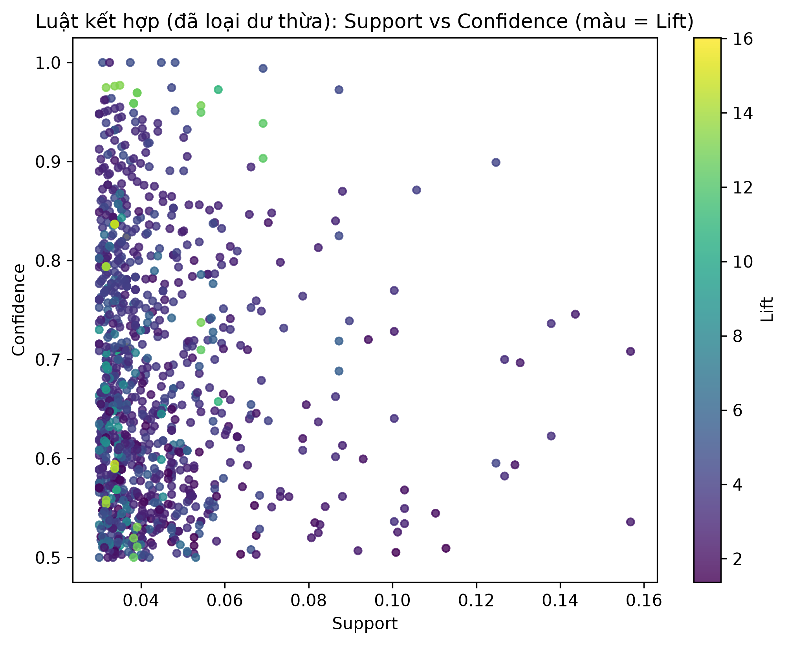
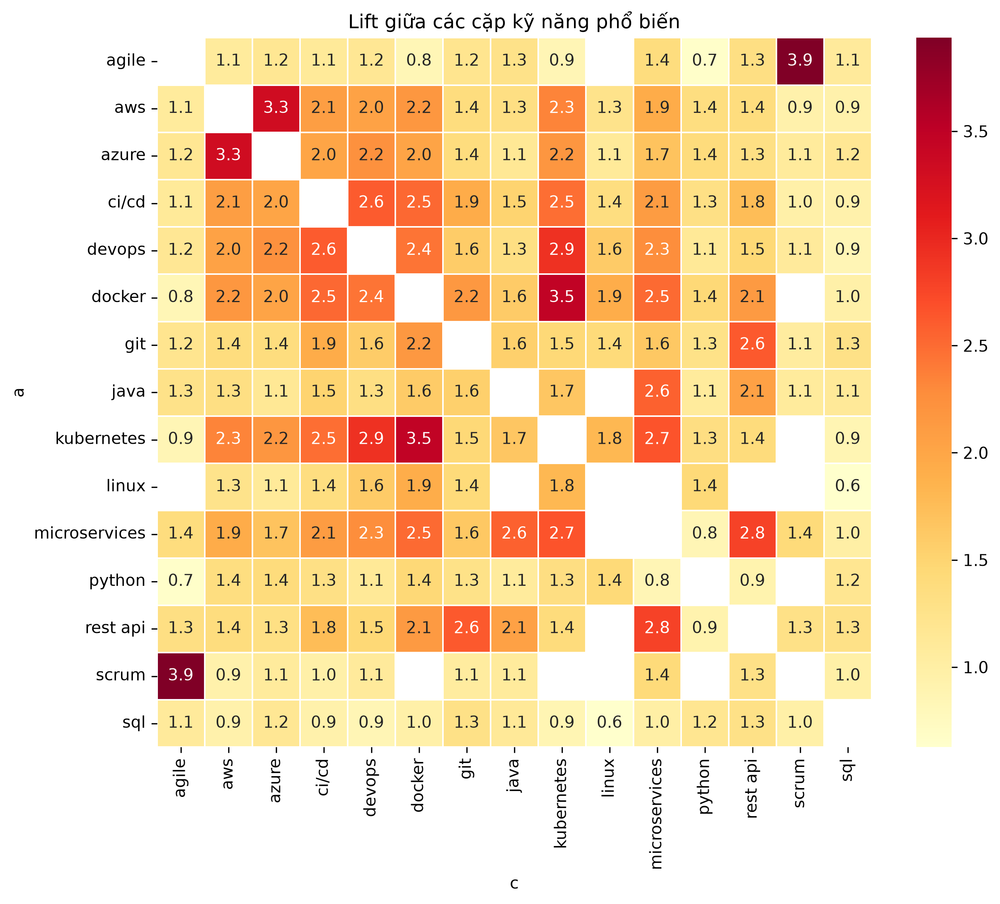

# Slide 1. Khai phá luật kết hợp kỹ năng trong tin tuyển dụng IT

**Phân tích thị trường việc làm IT Việt Nam · Apriori · FP-Growth**

- **Câu hỏi:** kỹ năng nào thường được yêu cầu **cùng nhau**? Mỗi tin = một "giỏ hàng", mỗi kỹ năng = một "món hàng", luật `A ⇒ B`: tin có A thì thường cũng có B

**Dữ liệu gốc** (`clean_data_processed.csv`)

| Số tin | Số cột | Nguồn | Phạm vi IT sơ bộ | Chờ xác nhận |
|:-:|:-:|:-:|:-:|:-:|
| **3.135** | 47 | 5 nguồn, một đợt thu thập | 2.869 | 266 (`pending_review`: PM/PO, Scrum Master, BA) |

**Sau khi lọc** (thuộc phạm vi IT, có JD sạch, bỏ kỹ năng hiếm < 30 tin, bỏ tin < 2 kỹ năng)

| Nguồn | TopCV | LinkedIn | ITviec | VietnamWorks | TopDev | **Tổng** |
|---|:-:|:-:|:-:|:-:|:-:|:-:|
| Tin (có JD sạch) | 1.138 | 637 | 530 | 477 | 61 | **2.843** |
| Giỏ kỹ năng (≥ 2 kỹ năng) | 894 | 591 | 496 | 396 | 53 | **2.430** |

Ma trận One-Hot **2.430 × 121** (157 → 121 kỹ năng). Top: python 36,8% · sql 32,2% · ci/cd 29,3% · docker 22,1% · aws 21,8%. **Mẫu số của mọi tỷ lệ là 2.430 giỏ.**

---

# Slide 2. Thước đo, sinh luật và lọc bớt luật

| Thước đo | Công thức | Ý nghĩa |
|---|---|---|
| **Support** | n(A ∪ B) ÷ N | Tổ hợp phổ biến đến đâu |
| **Confidence** | n(A ∪ B) ÷ n(A) | Có A thì bao nhiêu % có B |
| **Lift** | Confidence ÷ Support(B) | > 1 kéo nhau lên · = 1 độc lập · < 1 ít đi cùng |
| **Conviction** | (1 − Support(B)) ÷ (1 − Confidence) | Luật sai ít hơn đoán ngẫu nhiên bao nhiêu lần |

**Ví dụ `docker ⇒ kubernetes`** (N = 2.430; Docker 538, Kubernetes 455, cả hai 335): support = 335 ÷ 2.430 = **13,79%** · confidence = 335 ÷ 538 = **62,3%** · lift = 62,3% ÷ 18,72% = **3,33**. Chiều ngược lại confidence = 335 ÷ 455 = **73,6%**, lift vẫn 3,33.

**Lọc luật:** 856 tập phổ biến sinh ra **4.018 luật thô**, lọc đồng thời bốn ngưỡng:

| Ngưỡng | Vì sao phải lọc |
|---|---|
| Support ≥ 0,03 (≥ 73 giỏ) | Luật hiếm có thể chỉ là trùng hợp |
| Confidence ≥ 0,5 | Ít nhất một nửa tin có A phải có B |
| Lift > 1,2 | Nếu B vốn rất phổ biến thì "A ⇒ B" luôn đúng mà không nói lên gì; lift loại luật độc lập hoặc ngược chiều |
| Conviction ≥ 1,2 | Luật phải đáng tin hơn đoán ngẫu nhiên |

**4.018 → 1.228 luật.** Ví dụ `python ⇒ sql` bị loại: lift 1,14 < 1,2 và confidence 36,8% < 50%.

**Loại luật dư thừa:** `A ⇒ C` bị bỏ nếu có luật ngắn hơn `A' ⇒ C` (cùng vế phải, `A'` ⊂ `A`) mà confidence không thấp hơn. Ví dụ `{spring, spring boot} ⇒ java` (83/83) dư thừa vì `spring ⇒ java` cũng 100% (117/117) và rộng hơn. **1.228 − 201 = 1.027 luật chất lượng.**

---

# Slide 3. Apriori so với FP-Growth

**Tham số chung:** `min_support = 0,03` (≈ 73 giỏ), `max_len = 4`

| | Apriori | FP-Growth |
|---|---|---|
| Cách làm | Sinh tập ứng viên từng tầng, đếm lại dữ liệu; cắt tỉa theo nguyên lý "tập không phổ biến thì mọi tập chứa nó cũng không" | Nén dữ liệu vào cây FP-tree, khai phá trực tiếp, không sinh ứng viên |
| Số tập phổ biến | **856** | **856** |
| Thời gian | **0,102 s** | 0,279 s |

| Kích thước tập | 1 kỹ năng | 2 | 3 | 4 | **Tổng** |
|---|:-:|:-:|:-:|:-:|:-:|
| Số tập | 79 | 351 | 331 | 95 | **856** |

- Hai thuật toán cho **cùng tập kết quả** (`set == set` là `True`) → kết quả đúng
- FP-Growth chậm hơn vì dữ liệu nhỏ (2.430 × 121), chi phí dựng cây không đáng; nó chỉ vượt trội khi dữ liệu lớn, support thấp hoặc tổ hợp dài. Thời gian cỡ phần trăm giây chỉ đo một lần nên không kết luận mạnh
- Số tập đạt đỉnh ở kích thước 2. Chỉ **79/121** kỹ năng đạt ngưỡng 73 giỏ, 42 kỹ năng còn lại không thể xuất hiện trong luật nào

---

# Slide 4. Biểu đồ 1: Support × Confidence (màu = Lift)

- **Dồn ở support thấp:** 90,8% luật có support < 6% (trung vị 3,7%), bên phải mốc 10% chỉ có 23 luật, vì 84% luật có từ 2 kỹ năng ở vế trái và tổ hợp càng dài càng hiếm
- **Luật phổ biến thì lift thấp:** các chấm phía phải màu tím đến xanh dương (lift 2–4), vì vế phải vốn đã xuất hiện nhiều. Tương quan support–lift = **−0,14**
- **Lift cao nằm ở góc trên bên trái:** 62 luật lift ≥ 8, trong đó **60 luật có support < 6%**; cụm xanh lá/vàng ở confidence 95–98% là luật web front-end
- **Luật 100% không phải gắn kết nhất:** 5 chấm ở confidence = 1,0 (Spring, FastAPI, Scrum) chỉ có lift ≈ 4,8
- **Hai cạnh trái và dưới do ngưỡng lọc tạo ra** (`MIN_SUP`, `MIN_CONF`), không phải quy luật của dữ liệu
- **Chỉ 8 luật** có support ≥ 10% và confidence ≥ 70%, đều thuộc DevOps/Cloud và Agile:

| Luật | Support | Conf. | Lift | Luật | Support | Conf. | Lift |
|---|:-:|:-:|:-:|---|:-:|:-:|:-:|
| docker ⇒ ci/cd | 15,7% | 70,8% | 2,42 | azure ⇒ aws | 12,7% | 70,0% | 3,22 |
| devops ⇒ ci/cd | 14,4% | 74,6% | 2,55 | scrum ⇒ agile | 12,5% | 89,9% | 4,29 |
| kubernetes ⇒ docker | 13,8% | 73,6% | 3,33 | google cloud ⇒ aws | 10,6% | 87,1% | 4,00 |
| {ci/cd, kubernetes} ⇒ docker | 10,0% | 77,0% | 3,48 | {docker, kubernetes} ⇒ ci/cd | 10,0% | 72,8% | 2,49 |

**Kết luận:** luật mạnh thường *chuyên biệt*, luật phổ biến thì gắn kết *vừa phải*; không luật nào nổi trội cả ba thước đo.

---

# Slide 5. Biểu đồ 2: Heatmap Lift của 15 kỹ năng phổ biến nhất

- **Khối đỏ DevOps/Cloud:** giữa docker, kubernetes, devops, ci/cd, aws, azure, microservices, postgresql, lift phần lớn **1,9 → 3,3**. Đậm nhất: docker ⇄ kubernetes **3,33**, aws ⇄ azure **3,22**, kubernetes ⇄ devops 2,85, microservices ⇄ rest api 2,68; ci/cd ⇄ devops, docker ⇄ postgresql, java ⇄ microservices, git ⇄ rest api khoảng 2,5
- **AWS và Azure** là hai nền tảng cạnh tranh nhưng lift tới 3,2, có thể vì nhiều tin liệt kê nhiều nền tảng cloud cùng lúc
- **Hàng "lạnh" của SQL:** lift 0,6 → 1,4; dưới 1 với linux **0,6** (thấp nhất bảng), devops 0,8, kubernetes 0,8, aws/ci/cd/docker 0,9; cao nhất là postgresql 1,4 (cùng nhóm cơ sở dữ liệu)
- **Hàng "lạnh" của Python:** agile 0,7, microservices 0,8, rest api 0,9, java và postgresql ≈ 1,0
- **Python và SQL phổ biến nhất nhưng ít gắn kết:** chúng xuất hiện ở mọi loại việc nên không đặc trưng cho cụm nào → có **hai hướng tách biệt:** vận hành/hạ tầng (khối đỏ) và lập trình/dữ liệu nền (màu nhạt)
- **Ô trống:** linux không có luật với agile, java, microservices (không đạt 3% giỏ)
- **Hạn chế:** chỉ 15 kỹ năng nên không thấy cụm front-end và Java/Spring

**Kết luận:** cụm DevOps/Cloud gắn kết chặt nhất; Python và SQL là kỹ năng nền ít đi kèm kỹ năng khác.

---

# Slide 6. Các luật tiêu biểu

| Nhóm | Luật | Confidence | Lift | Nhận xét |
|---|---|:-:|:-:|---|
| Top Lift | android ⇄ ios | 71,2% / 82,4% | **16,0** | Cụm mobile |
| Top Lift | {html, react} ⇒ css | 97,7% | 13,3 | Cụm web front-end |
| Top Confidence | spring ⇒ java | 100% (117/117) | 4,77 | Framework thuộc ngôn ngữ, hiển nhiên |
| Top Confidence | fastapi ⇒ python | 100% (79/79) | 2,72 | Hiển nhiên |
| Chủ đề | docker ⇒ kubernetes | 62,3% (335/538) | 3,33 | Có Docker thì 62% có Kubernetes |
| Chủ đề | kubernetes ⇒ docker | **73,6%** (335/455) | 3,33 | Chiều ngược lại mạnh hơn vì Kubernetes ít phổ biến hơn |
| Chủ đề | machine learning ⇒ python | **80,0%** (128/160) | 2,17 | Python gần như đi kèm ML |
| Chủ đề | python ⇒ sql | 36,8% (329/894) | 1,14 | Liên kết yếu |
| Chủ đề | sql ⇒ devops | 16,0% (125/782) | **0,83** | Lift < 1: ít đi cùng hơn kỳ vọng |

- **Lift** cho thấy cụm kỹ năng của ngành, **Confidence** cho thấy quan hệ phụ thuộc kỹ thuật. `spring boot ⇒ java` chỉ 168/169 = 99,41%, không phải 100%
- **Không có luật `{python, sql} ⇒ machine learning`:** chỉ 56 giỏ (2,30%), thiếu 17 giỏ so với ngưỡng 73, confidence 56 ÷ 329 = 17,0%. Kết luận đúng là *"không tìm thấy luật ở ngưỡng đã chọn"*, không phải *"ba kỹ năng không đi cùng nhau"*

---

# Slide 7. Độ tin cậy, hạn chế và kết luận

**Độ tin cậy**

| Kiểm tra | Kết quả |
|---|---|
| Đổi mẫu số 2.430 giỏ → 2.843 tin | Support giảm ~14,5%; confidence gần như không đổi; lift tăng (×1,03 → ×1,17), ví dụ `python ⇒ sql` 1,14 → **1,28** |
| Bộ luật có ổn định? | **1.225/1.228** luật vẫn đạt ngưỡng; 3 luật rớt đều do confidence tụt sát dưới 50% |
| Đổi `MIN_COUNT` (10, 30, 50, 73, 100) | Từ 30 đến 50 bộ luật **không đổi** (1.228 luật); tham số quyết định là **`MIN_SUP`** |

**Hạn chế:** một đợt thu thập, nghiêng về TopCV (~37%) · không phân biệt kỹ năng "bắt buộc" và "ưu tiên" · ngưỡng do người làm chọn · luật chỉ mô tả đồng xuất hiện, không chứng minh nhân quả · 103 tin `pending_review` bị loại tạm thời

**Kết luận**
1. **DevOps/Cloud** là cụm gắn kết chặt nhất (Docker ⇄ Kubernetes 3,33; AWS ⇄ Azure 3,22)
2. **Python và SQL** phổ biến nhất nhưng ít gắn kết (Python ⇒ SQL chỉ 1,14)
3. Luật confidence 100% chủ yếu là quan hệ kỹ thuật hiển nhiên
4. Luật mạnh thì chuyên biệt, luật phổ biến thì gắn kết vừa phải

**Hướng phát triển:** gợi ý lộ trình học · phân cụm công việc theo kỹ năng · kết hợp với lương và kinh nghiệm
